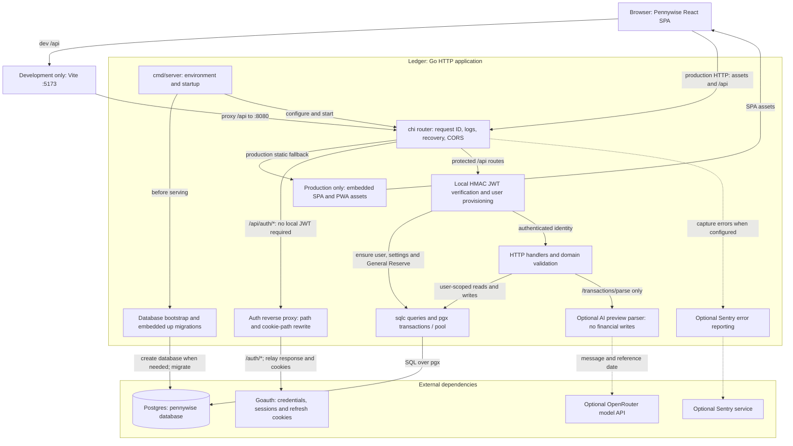

# Application architecture

Pennywise is the React browser application; Ledger is its historical Go service
name and module namespace. One Go HTTP application owns the financial API and
Postgres access. Goauth is an external authentication service, not a financial
microservice. The UI is personal-ledger oriented, but API data is scoped by the
verified user's UUID; this is not one shared anonymous ledger.

## Backend request and startup flow

1. [`cmd/server/main.go`](../backend/cmd/server/main.go) loads `.env` from its
   working directory, then environment-backed [configuration](configuration.md).
   Before listening it bootstraps the application database, runs embedded up
   migrations and opens/pings a pgx pool. Failure prevents serving. With a URL
   targeting another database, bootstrap checks/creates `pennywise` and rewrites
   the database path. A URL already targeting `pennywise` must point to an existing
   database. Database creation needs the appropriate Postgres privilege.
2. [`internal/api/server.go`](../backend/internal/api/server.go) wires chi request
   IDs, logging, recovery, Sentry middleware and CORS. `/health` pings the pool;
   it does not verify Goauth or OpenRouter availability. `/api/auth/*` bypasses
   local token verification and is forwarded to Goauth `/auth/*`. The
   [proxy](../backend/internal/auth/proxy.go) relays cookies and rewrites their
   `/auth` path to `/api/auth`; other cookie attributes remain upstream-owned.
3. Other registered API routes pass through the local
   [JWT verifier](../backend/internal/auth/auth.go) and
   [provisioning middleware](../backend/internal/api/users.go). Tokens use the
   shared HMAC secret and a UUID identity claim (configured claim with `sub`
   fallback). The verifier accepts HMAC signing methods, not only HS256; the dev
   token tool issues HS256. Provisioning idempotently ensures the user, settings
   and General Reserve, not template rows or a demo dataset.
4. Handlers enforce domain rules and use generated
   [`internal/db`](../backend/internal/db) queries over pgx, including explicit
   transactions/locks where the workflow needs atomicity. SQL sources live in
   [`db/queries`](../backend/db/queries); embedded migrations live in
   [`db/migrations`](../backend/db/migrations). There is no implemented queue or
   separate job service in this request path.
5. Optional AI parsing calls OpenRouter through
   [`internal/transactionparser`](../backend/internal/transactionparser) and
   returns editable previews; saving is a separate transaction API request.
   It sends the submitted message and reference date, not saved history. Optional
   Sentry receives backend error telemetry. Neither dependency is needed for
   ordinary financial CRUD; set both OpenRouter key/model or neither.

## Canonical diagram

Solid arrows are local or required request/data paths; dotted arrows are optional
external integrations. Development and production asset paths are alternatives,
not two deployed backend services. Router middleware is summarized in one node.
The diagram's source is [`architecture.mmd`](architecture.mmd).

## Browser and build boundary

In development, [Vite](../frontend/vite.config.ts) serves the SPA on `:5173` and
proxies `/api` to Go on `:8080`. The non-`prod` Go build embeds no web assets.
In production the root [Dockerfile](../Dockerfile) builds the frontend, copies
`dist` into `backend/web/dist`, then compiles Go with `-tags prod`.
[`web/embed_prod.go`](../backend/web/embed_prod.go) embeds those files; the
backend serves assets with SPA fallback. HTML and service-worker entry points
are revalidated, while hashed `assets/` files get immutable caching.

The [frontend API client](../frontend/src/api/client.ts) uses same-origin `/api`.
Access tokens use tab-scoped `sessionStorage`, while refresh uses the upstream HttpOnly cookie;
see [session behavior](../frontend/README.md#session-resilience). The PWA precaches an app shell,
not a financial database or offline write queue. API access and financial writes
still require a network connection. [Clarity initialization](../frontend/src/main.tsx)
is a separate browser-side analytics integration, not part of Go API processing.

## Financial boundaries

Normal expense rows distinguish incurred cost (`cash + credit`) from cash-out
(`cash + settlement`); a settlement may link earlier credits without counting
those purchases twice in incurred totals. Income must be cash. Monthly budgets
are separate per-month records, not global settings. See the
[backend model and API](../backend/README.md#the-data-model-why-it-exists).

Lents and chits use separate tables and do not automatically affect ordinary
transaction analytics. Event plans are also separate, but explicit event
conversion can create and link an ordinary transaction. Reserves use signed
entries and operation history: direct deposits, reserve-only spending and
reserve-to-reserve transfers do not create normal transactions; income-transfer
and funded-expense operations do. Generated rows are linked and protected by
the reserve workflow. These are domain boundaries inside the same application
and database, not separate services.

For routes, financial formulas, validation and transfer limits, use
[backend/README.md](../backend/README.md). For SPA routes and interaction behavior,
use [frontend/README.md](../frontend/README.md). The root
[auth-api-spec.json](../auth-api-spec.json) documents Goauth only; it is not the
Pennywise API contract.
