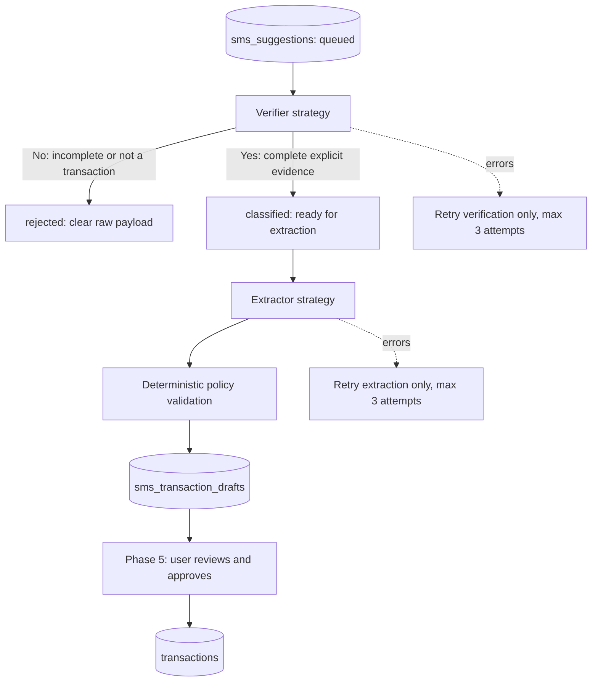

# Phase 4: replaceable SMS verification and extraction

## Implemented scope

Two independent Go strategy interfaces turn SMS source rows into durable drafts. The default implementations use the same existing OpenRouter key/model as natural-language previews. The natural-language parser itself is unchanged and is not called by this pipeline.

There is no incomplete-message review queue, no settlement ledger conversion, no automatic ledger insert, and no learned/history-based section matcher. This document records the Phase 4 milestone. [Phase 5](android-sms-phase5.md) now implements Draft review/editing/approval and the create-transaction integration; its contracts supersede the review-availability statements below.



## Business policy

Stage 1 produces a strict yes/no decision. A positive decision must include:

- An explicit calendar transaction date, including year, quoted from the SMS body. Received date, missing-year inference, relative dates, and time-only text are not substitutes.
- A positive transaction amount, not available balance or credit limit.
- An evidenced counterparty/merchant/payer/purpose.
- Money direction (`debit` or `credit`) and financial event type.

Incomplete/ambiguous/non-transaction messages are `rejected`, never `needs_review`. OTP-only, promotions, reminders, requests, failed/pending payments, and multi-transaction statements are not eligible. Provider errors or malformed responses are processing failures, not negative financial decisions.

Explicit dates support ISO, Indian day-first slash/dash dates, and named months, with 2- or 4-digit years. Numeric dates are day-first; no month-first locale inference. Two-digit year interpretation follows Go date parsing, restricted to years >= 2000. Date/amount/counterparty evidence must be exact body substrings; normalized extraction date/amount must agree with the verified evidence.

The backend, not the model, determines ledger kind:

| Evidence | Proposed kind | Warning |
|---|---|---|
| Explicit card transaction, including debit card under the owner's chosen policy | `credit` | `card_mapped_to_credit` |
| Explicit bank/UPI/non-card transaction | `cash` | — |
| Missing/uncertain payment method | `cash` | `cash_defaulted` |
| Suspected settlement/card-bill payment | `cash` regardless of card wording | `possible_settlement_review` |

This is a deliberate product mapping, not a claim that debit-card purchases are credit borrowing. Proposing a card-bill payment as cash can double-count spending if approved alongside the card purchases; the review warning is mandatory. There is no `settlement` draft kind or settlement linking in this phase.

Sections (`daily`, `essential`, `flexible`, `income`) are optional AI suggestions. Unknown sections remain null. An income section incompatible with card kind is cleared instead of violating the existing ledger invariant. History-based matching/training is a separate future task and no existing transaction history is sent to either strategy.

Direction/event type are retained separately from payment kind. Incoming credits, refunds, and transfers carry review warnings; being a credit does not prove income. Currency can default to the account's configured currency with a warning when absent; explicitly different currency fails validation rather than silently converting.

## Module interfaces and replacement seam

`backend/internal/smspipeline/`:

| File/module | Responsibility |
|---|---|
| `types.go` | Provider-neutral `Verifier`, `Extractor`, `Store`, input/result types |
| `openrouter.go`, `prompts.go`, `output_schema.go` | Independent `OpenRouterVerifier` and `OpenRouterExtractor` adapters; shared bounded transport and strict structured-output checks |
| `policy.go` | Readiness evidence checks, explicit-date policy, decimal validation, accounting defaults and warnings |
| `worker.go` | One-stage-at-a-time orchestration through injected interfaces |
| `postgres.go` | Claims, consent/config fencing, stage completion, atomic draft persistence, backoff |
| `retry.go` | Owner-scoped retry of the failed stage only |

The worker receives its store, verifier and extractor in its constructor. Neither strategy calls the other; neither imports the existing transaction parser. A new provider only implements the relevant interface and replaces that adapter in `cmd/server/main.go`. There is no new plugin runtime or provider SDK type in the strategy interfaces.

## Configuration

```dotenv
# Existing configuration, reused rather than copied into a second secret:
OPENROUTER_API_KEY=...
OPENROUTER_MODEL=...
OPENROUTER_TIMEOUT=15s

# SMS is off until explicitly enabled by the operator:
SMS_AI_ENABLED=false
SMS_AI_POLL_INTERVAL=2s
# Optional override for both default SMS strategies; otherwise OPENROUTER_MODEL:
SMS_AI_MODEL=
```

`OPENROUTER_BASE_URL`, site URL and app attribution are also reused. Both stages initially use the same key/model but distinct prompts, output schemas and prompt versions. Natural-language preview behavior and its model remain unchanged by an SMS model override. Disabling the SMS worker does not disable upload ingestion, and does not pause the existing seven-day raw-payload retention.

Configuration is read at server startup; restart to apply changes. When enabled, the server starts one SMS worker loop alongside retention maintenance and cancels both on shutdown. The poll interval also bounds stage-request cadence while work is available, rather than spinning through immediate provider errors. Multiple server instances safely claim different source rows. Default adapters honor request cancellation/timeouts and disable SDK retries: only the durable worker schedules retries. A provider call can still repeat after process death or lease expiry; uniqueness prevents duplicate drafts, not duplicate provider billing.

## Persistence and states

Migration `0017_sms_ai_pipeline` extends `sms_suggestions` and creates `sms_transaction_drafts`.

| Source status | Meaning |
|---|---|
| `queued` | Awaiting verification |
| `verifying` | Leased verification attempt |
| `classified` | Verified complete; ready for extraction |
| `extracting` | Leased extraction attempt |
| `rejected` | Strict negative decision; raw payload cleared |
| `failed` | A stage exhausted its three attempts; explicit retry required |
| `pending_review` | Extracted draft committed, awaiting future human approval |
| `cancelled` | Disabled/revoked/removed sender/expired source |
| `approved`, `ignored` | Reserved for the Phase 5 review flow |

Legacy `uncertain` rows migrate to `rejected`; no new uncertain state is produced. `verification_attempts` and `extraction_attempts` are separate and increment durably at claim time, so crashes consume an attempt. Retryable failures use exponential backoff. A crash lease resumes the same stage; after three attempts it becomes failed. A fresh claim token fences late responses from earlier workers.

A claim uses a short `FOR UPDATE SKIP LOCKED` transaction. Provider IO happens outside transactions. Before each call and final commit, the store checks current consent/version, revocation, sender eligibility, raw-payload availability, retention age and claim identity. Configuration/device changes can prevent later stages or discard an in-flight result; already-sent requests cannot be recalled.

`INSERT draft + mark source pending_review` is one transaction. Unique `source_sms_id` prevents duplicate draft rows. Composite ownership foreign keys bind drafts to their source account. The draft contains basic fields rather than copying the ledger's complete schema: date, category/name, amount, optional section, kind, currency, direction, event type, warning codes and application-owned identity/timestamps. No AI-generated IDs or ownership are accepted.

Raw SMS and transient verification evidence are cleared on rejection, cancellation, successful extraction, or expiry. Financial draft fields remain available for human review. Processing usage stores provider/model, prompt version and token counts, not provider response bodies. A down migration discards unsaved drafts; back up the database before rollback.

## Read/retry endpoints (web JWT only)

- `GET /api/sms/jobs`: up to 100 recent owner-scoped processing statuses, stage attempts and safe reason/error codes. No raw messages or verification evidence.
- `POST /api/sms/jobs/{id}/retry`: retries only a failed, still-eligible, unexpired job's failed stage. Rejected/cancelled rows cannot be revived. Foreign/ineligible/nonfailed jobs return a generic conflict.
- `GET /api/sms/drafts?offset=0`: up to 50 pending drafts plus `next_offset`, basic transaction fields, warnings and `section_is_suggestion=true`.

Opaque Android device tokens cannot use these endpoints. No approve/save endpoint was introduced. The existing transaction creation API is unchanged; Phase 5 must add an atomic, owner-scoped, duplicate-safe approval linkage before exposing approve actions.

## Prompt-injection and privacy guardrails

- A fixed developer instruction is separate from JSON-encoded untrusted SMS/evidence data. No browsing, executable tools, arbitrary callbacks, existing transaction history, or ledger-write capability is available to either model.
- Each request exposes exactly one forced output function. It is a structured data envelope, not an executable transaction tool.
- Local checks enforce required keys, primitive types, allowed enums, no unknown fields, exact decimal limits and agreement with source evidence. A model's positive flag is not sufficient.
- Responses are capped at 64 KiB and completions at 1,536 tokens. HTTP and worker timeouts are bounded.
- SMS-specific provider errors are reduced to fixed codes. No raw SMS, prompts, completions, provider error text, or API keys enter logs. SMS HTTP routes bypass Sentry request-body capture.
- Provider routing follows the existing `data_collection=deny` and `zdr=false` settings; this is not a zero-retention guarantee. Both paid calls use the opted-in provider.
- Injection resistance is not a guarantee of model correctness. Even a misleading model output remains an unapproved draft; it cannot itself perform a ledger action.

## Verification

Tests use synthetic fixtures, fake strategies and an HTTP OpenRouter stub, not live paid requests. Coverage includes strict date/completeness rejection, card/cash/default/settlement-warning policy, section optionality, source amount/date consistency, independent strategies using the same key/model, malformed/provider-error handling, stage-specific retries, crash lease recovery, stale-claim fencing, opt-out during IO, draft uniqueness, source privacy cleanup, and account/token isolation. Existing natural-language parser tests remain unchanged.

Verification results:

- Go package tests and `go vet ./...` pass.
- Focused SMS/provider/configuration tests pass with the race detector against disposable PostgreSQL; no live provider key or paid calls were used.
- API integration regression and migration up/down round trips pass with the previously reproduced baseline `TestArchivedReserveSpendingCannotBeDeleted` failure excluded. The rollback index/column dependency found by that suite was fixed.
- All 340 frontend tests and the production web build pass (`NODE_OPTIONS=--no-experimental-webstorage` is needed for the existing Node/jsdom storage clash).
- Android JVM tests, APK build and lint pass after updating disclosures. Emulator instrumentation from Phase 3 was not rerun for these copy-only Android changes.
- Physical-phone SMS access and a consented live-provider sample remain rollout checks, not claims made by fixture tests.
