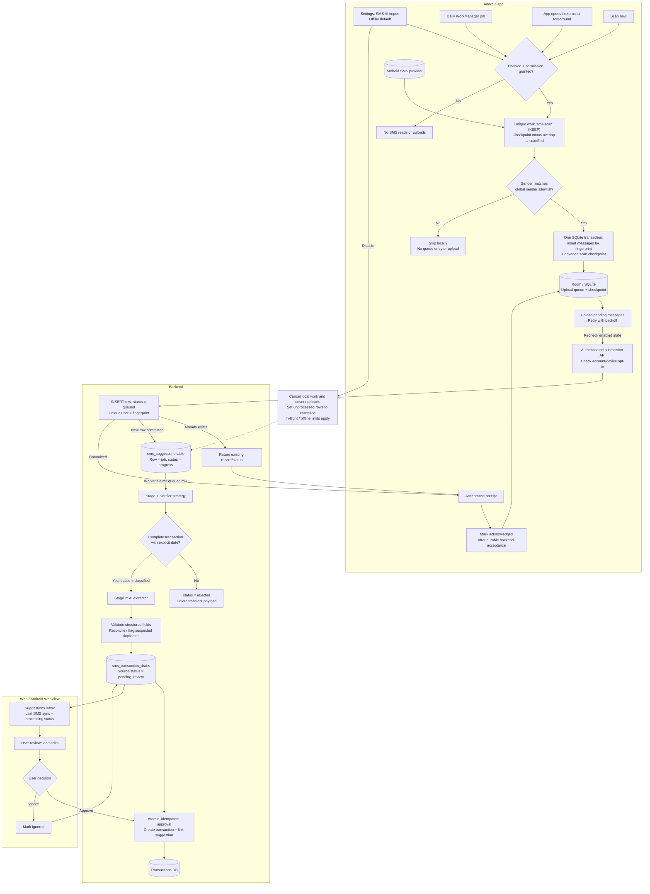

# Android SMS transaction import: research and initial plan

Researched: 2026-10-20. Updated 2026-10-24: phases 2–4 backend/manual-delivery code is implemented. Phase 4 uses independent verifier/extractor strategies and a separate transaction-draft table. The SMS AI worker is off by default. Phase 5 now adds review/edit/approval UI and atomic ledger creation; automatic scanning remains a future phase. Real-phone and live-provider validation gates remain open.

## Implementation status

See [phases 1–3 implementation and API contracts](android-sms-ingestion-implementation.md) for ingestion setup and [Phase 4 implementation](android-sms-phase4.md) for the current strict verification/extraction rules, strategy interfaces, states, configuration and read/retry endpoints. `SMS_AI_ENABLED=true` enables backend processing with the existing OpenRouter key/model; otherwise uploads stay queued until processing or expiry. [Phase 5 review/approval](android-sms-phase5.md) is implemented; daily and foreground scan triggers remain Phase 6.

## Selected architecture decision

Target a **personally installed Android APK** with an opt-in **daily background scan + foreground catch-up → local sender allowlist → local SQLite queue → backend deduplication → AI classification → AI extraction → suggestions inbox → manual approval** flow. This supersedes the initial recommendation for foreground-only scans and local rule-based parsing. The application maintains a global sender allowlist shared by all users (for example, `AD-ICICIB`), manually updated by the maintainers. Android loads a cached copy at startup and filters by that list before queueing or uploading messages. No custom body-keyword classifier or bank-specific local transaction parser is planned; sender filtering precedes the two AI stages.

AI processing has two distinct stages:

1. A replaceable verifier strategy makes a strict yes/no completeness decision. A meaningful completed transaction must have an explicit unambiguous date including year, amount, counterparty/purpose, direction and event type. Missing/ambiguous details mean rejection, not a needs-review queue. Unknown payment method is allowed and defaults to cash later.
2. Only accepted messages reach a separate replaceable extractor strategy. Both initially use the existing OpenRouter key/model, with distinct SMS prompts/schemas rather than the natural-language parser. Deterministically validated results go to `sms_transaction_drafts`, never automatically to the ledger. Future providers can replace either strategy independently.

Expose **SMS AI import** in Settings, off by default. Disabling it must stop scheduling, SMS reads, queued uploads, and further AI processing where cancellation is still possible. Previously sent requests cannot be recalled. Existing suggestions remain available for review.

Only allowlisted senders are eligible for upload, but cloud classification still means their messages leave the device before financial relevance is known. Explicit opt-in must disclose that allowlisted senders can also send OTPs, promotions, and other non-transaction content to the first-stage service; the sender filter and second stage do not eliminate this exposure. This personal-APK decision is not a Google Play-compliant publication plan.

Confirm supported banks/countries/languages and provider choices before implementation. Scope remains carrier SMS, not bank-app notifications, RCS, or WhatsApp.

## Platform and distribution findings

### Reading SMS is technically possible without becoming the default SMS app

Android's Telephony provider allows non-default apps to read SMS subject to permissions; only the default SMS app can write to that provider. Query stored received messages through `ContentResolver` and `Telephony.Sms.Inbox.CONTENT_URI` with `READ_SMS`. Incoming-message broadcasts are a separate capability: `SMS_RECEIVED_ACTION` requires `RECEIVE_SMS`. [1][2]

Both SMS permissions are dangerous and hard-restricted: runtime consent is not the only gate; the installer must allowlist the restricted permissions. Consequently, personal installation avoids Play's publication review but does not bypass Android's permission restrictions. Validate the actual installer, phone, and Android version in a small feasibility spike before committing to the UX. [3]

The proposed first release needs `READ_SMS`, not `SEND_SMS`, contacts, call logs, or MMS permissions. Request `RECEIVE_SMS` only if a later release genuinely needs incoming-message handling. A foreground rescan can discover messages received while the app was closed.

### Google Play has a relevant exception, but it requires review

Google Play explicitly lists **SMS-based money management**, including apps that track/manage budgets, among possible exceptions for non-default SMS handlers. Its eligible permissions include `READ_SMS` and `RECEIVE_SMS`. However, Google describes these as reviewable exceptions, requires critical core functionality with no alternative method, and requires a Permissions Declaration Form. Eligibility is not approval. Make SMS-based budgeting prominent in the app/store description and plan privacy disclosures, consent, a demonstrable review flow, and accurate Data safety declarations. Recheck policy before publication. [4]

The same policy specifically says budgeting apps must not exfiltrate or share non-financial or personal SMS history. [4] The selected cloud-first classification design can upload such messages and therefore must be reconsidered before any Play release; personal consent alone does not satisfy that publication restriction.

### Other APIs are not equivalent substitutes

- **SMS Retriever / SMS User Consent:** verification-code APIs, not general inbox-reading APIs. User Consent shares one incoming verification SMS with consent; it does not scan historical messages. [5][6]
- **Notification listener:** works with notifications, not the SMS database. It is a separate opt-in integration, dependent on notification availability/content and platform restrictions; do not promise inbox history or reliable bank coverage through it. Do not treat it as a Play-policy bypass. [7]
- **Share/paste:** a useful permission-free fallback. Accept deliberately shared `text/plain` content where the messaging app supports sharing, or offer a paste field. This is manual import, not background inbox access. [8]
- **RCS / WhatsApp:** outside this SMS-provider integration. Do not label the feature as reading “all messages.”

## Fit with this repository — pre-implementation baseline

These observations were recorded before phases 2–4 and explain the original integration choices. They are not a current dependency/permission inventory; see the implementation documents for shipped behavior. The initial graph queries did not surface useful Android implementation nodes:

- `android/README.md` and `android/app/src/main/java/app/pennywise/MainActivity.kt`: Android is a Kotlin WebView wrapper around the hosted app, not a native transaction client.
- `android/app/src/main/AndroidManifest.xml`: currently requests only `INTERNET`.
- `android/app/build.gradle.kts`: minimum SDK 29, target SDK 35; no local candidate database currently declared.
- `MainActivity.kt`: an existing `PennywiseAndroid` JavaScript interface supports downloads. Navigation checks compare the main-frame host, and subframes are permitted. This is not sufficient authorization for sensitive SMS operations.
- `backend/README.md`, “AI transaction previews”: `/api/transactions/parse` sends text through OpenRouter and creates previews only. It is intended for short everyday-language entries, has rate limits, and defaults unspecified payment method to `cash`. Do not directly reuse those assumptions for bank alerts.
- `backend/internal/api/import.go`: `/api/transactions/import` validates up to 2,000 rows and inserts them atomically, but accepts no source/idempotency key and does not deduplicate. It rejects settlements. SMS approval does not use it; it uses the create transaction API instead (see §6).

## Proposed architecture



The checkpoint means **safely queued locally**, not uploaded or AI-processed. After durable backend acceptance, processing no longer depends on the Android app staying alive. See the sections below for retry, cancellation, and deduplication details.

```text
User enables SMS AI import in Settings
  → native disclosure + Android READ_SMS permission
  → daily WorkManager job OR foreground catch-up / Scan now
  → all enqueue unique work `sms-scan` (KEEP), gated by current opt-in + permission
  → bounded received-SMS query since checkpoint, with overlap
  → local cached global sender allowlist: skip nonmatching messages
  → one local SQLite transaction: queue matching messages + advance checkpoint
  → resumable authenticated upload of pending queue entries
  → backend inserts each unique fingerprint as a `queued` row in `sms_suggestions` (the row is the job)
  → acknowledge local entries only after that insert commits
  → backend worker claims queued rows (FOR UPDATE SKIP LOCKED)
  → stage 1 verifier: strict yes/no completeness including explicit date
      → no: reject, clear raw payload, retain minimal deduplication status
      → yes: source becomes classified, ready for separate extraction
  → stage 2 extractor + deterministic validation
  → atomically insert unique transaction draft + set source to pending_review
  → user reviews, edits, approves or ignores
  → atomic, idempotent approval creates transaction + links suggestion
```

### 1. Narrow native SMS module

Create a focused Android module/package for permission handling, bounded inbox queries, scheduling, and a durable upload queue. Read only the columns needed: source row ID, sender, message body, receive timestamp, and subscription metadata where necessary. Close cursors, support cancellation, and never query on the main thread.

Use WorkManager for daily best-effort work near the selected time, plus foreground catch-up when the app opens/returns to foreground and an explicit Scan now action. All three triggers (daily timer, app open, Scan now) only enqueue one-time unique work named `sms-scan` with `ExistingWorkPolicy.KEEP`; WorkManager runs at most one job with that name, and requests while it is queued or running are ignored. The daily periodic job does no scanning itself: it only enqueues `sms-scan` (it cannot share that name, since periodic work is always enqueued and `KEEP` would then block Scan now forever). This replaces a custom scan lock. Throttle frequent foreground transitions. Ordinary process death must not lose the queue or scan state. WorkManager supports persistent scheduling across process restarts and reboots, but execution is not exact: battery/manufacturer restrictions can delay it, force-stop can prevent work until the app is reopened, and uploads must wait for connectivity. No Android mechanism guarantees fresh web data if the phone cannot run/sync.

#### Global sender allowlist, enforced locally

Maintain one global list of permitted sender IDs shared by all users, not a per-user Settings list. Maintainers manually update it regularly. Prefer a backend database/config table as the authoritative source, exposed through a read-only, versioned configuration endpoint. Android loads its last-known-good cached snapshot at startup and refreshes it on startup and before background scans when connectivity permits. Cache the snapshot in local persistent storage so offline scans do not depend on fetching configuration. A bundled properties/JSON file can provide an initial snapshot; a bundled-only list would require app releases to distribute changes.

For example, a global entry `AD-ICICIB` permits messages with that sender to proceed to the queue and backend AI classifier. An explicitly empty list permits no messages; do not fall back to uploading all senders. If there is no valid cached or bundled snapshot and refresh fails, skip scanning/uploading until configuration is available. Validate configuration before atomically replacing the cache; failed or malformed refreshes retain the last-known-good snapshot. Restrict allowlist writes to maintainers; ordinary users can only enable/disable the overall SMS AI import feature.

Use exact full sender-ID matching by default after documented minimal normalization (trim surrounding whitespace and normalize ASCII letter case). Do not silently use substring matching, strip routing prefixes, or infer bank families: `AD-ICICIB` and another prefixed variant are separate entries unless maintainers add both. If family/wildcard support is introduced later, make its wider scope explicit in the maintained configuration. Sender IDs are routing signals, not proof of bank authenticity.

Apply this gate locally before persisting upload payloads. Read the sender column first and avoid accessing/copying nonmatching message bodies where practical; a bounded metadata scan may still inspect sender IDs for nonmatching messages. Nonmatches must not be uploaded or sent to either AI stage. Matching messages still require AI relevance classification and extraction; an allowlisted sender does not make every message a transaction.

Version global allowlist snapshots and serialize local snapshot replacement with scans/queue commits. Record the snapshot version used for queueing and recheck current sender eligibility before upload. Removing a sender must stop new queue entries and uploads for it once the device receives the update, and purge its unsent payloads. The backend must independently enforce its current authoritative allowlist on submission and before each AI stage, cancelling pending processing for removed senders where possible. Offline clients can temporarily use a stale snapshot, but it cannot bypass backend enforcement; already-sent provider requests cannot be recalled.

Adding a sender affects future scans after refresh. Offer an explicit bounded historical rescan for older messages because the shared checkpoint may already have passed them; a global list update must not silently authorize an unlimited historical scan. Existing suggestions remain reviewable.

#### Local SQLite queue and scan checkpoints

Use Room over SQLite for the durable queue and scan state, scoped to the authenticated account and scan source. A checkpoint is an application-owned saved position, not an Android API. Keep it separate from upload acknowledgements and backend AI status.

Suggested records:

- `sms_scan_state`: account/source scope, `last_completed_scan_end`, and checkpoint/schema version.
- `sms_upload_queue`: account scope, versioned fingerprint, required SMS payload, `pending`/`uploading`/`acknowledged` state, attempt count, next retry time, and backend processing ID where available. Enforce local uniqueness on account + fingerprint. Recover stale `uploading` entries after process death.

For each scan:

1. Verify opt-in/permission (the `sms-scan` unique work already guarantees only one scan runs).
2. Read the checkpoint and capture a fixed `scanEnd` before querying. For the first scan, explicitly select/disclose a start boundary (for example, the start of today); never implicitly upload the entire inbox.
3. Query received SMS in `[checkpoint - overlap, scanEnd)`, or the selected initial range. The configurable overlap catches some delayed messages; fingerprint uniqueness makes repeated reads safe.
4. After successfully scanning the complete bounded range, commit queue inserts for allowlisted senders and checkpoint advancement to `scanEnd` in **one SQLite transaction**. A range with no matching senders still advances the checkpoint after a successful scan. Duplicate queue inserts are harmless. Do not advance on permission loss, cursor failure, cancellation, or incomplete reads. Recheck the enabled/configuration version before committing so disable cannot be followed by a stale scanner persisting new payloads.
5. Upload pending entries separately. Acknowledge each only after durable backend acceptance, including responses for previously accepted duplicates. Network failures/timeouts retry the same fingerprint with backoff; do not rescan to recover uploads.

```text
BEGIN SQLITE TRANSACTION
  INSERT allowlisted queue entries, ignoring existing account + fingerprint
  UPDATE scan checkpoint to scanEnd
COMMIT
```

A crash before commit leaves neither change; a crash after commit leaves both. Thus the checkpoint means **scanned and safely queued**, not uploaded, classified, or extracted. Keep scans bounded; if pagination/chunking is needed, define a resumable cursor and commit only completely captured ranges rather than advancing to an unread endpoint. Clock rollback must not move a checkpoint backward or skip a future scan.

Overlap cannot catch every restored SMS with an old timestamp. Offer an explicit bounded historical rescan using the same deduplication path. If opt-out purges unsent entries, define a fresh start boundary on re-enable and offer explicit catch-up rather than silently uploading the disabled period.

#### Resumable backend handoff and web freshness

Keep Android work bounded to scanning/queueing/uploading; do not wait for AI inside the worker. The backend acknowledges once the row insert below commits; a duplicate upload returns the existing record/status. Presence of a row alone is not proof of success; its `status` says how far it got.

#### Backend processing: the suggestions table is the job queue

The backend has no job system today, and this feature does not need one. Every uploaded SMS becomes one row in `sms_suggestions`. That row is the job, and its `status` is its position in the pipeline. Accepting an upload and creating its job is a single `INSERT`, so no transactional outbox or separate queue has to be kept in sync.

```sql
INSERT INTO sms_suggestions (user_id, fingerprint_version, fingerprint, sender, received_at, body)
VALUES (...)
ON CONFLICT (user_id, fingerprint_version, fingerprint) DO NOTHING;  -- new rows start as 'queued'
```

`body`, `sender`, and `received_at` must be nullable columns: they are cleared when a row becomes `rejected`. The upload API still requires all three on insert.

When enabled, one worker loop claims one stage at a time using a short `FOR UPDATE SKIP LOCKED` transaction, increments that stage's attempt counter, persists a claim token/timestamp, and commits **before** provider IO. It rechecks consent, sender eligibility and claim identity before each call and before saving results. No database transaction stays open during a provider request.

| Status | Meaning | Next |
|---|---|---|
| `queued` | Awaiting strict verification | `verifying` |
| `verifying` | Leased verification attempt | `classified`, `rejected`, retry/`failed` |
| `classified` | Complete transaction; ready for extraction | `extracting` |
| `extracting` | Leased conversion attempt | `pending_review`, retry/`failed` |
| `rejected` | Non-transaction or incomplete/ambiguous; raw payload cleared | — |
| `failed` | Three attempts exhausted for one stage | Explicit retry of that stage only |
| `pending_review` | Separate draft committed; awaits Phase 5 human decision | `approved`, `ignored` |
| `approved` / `ignored` | Human decision reserved for Phase 5 | — |
| `cancelled` | Disabled/revoked/removed sender/expired source | — |

- **Crash mid-stage:** expired leases resume the same stage, consuming an attempt. Fresh claim tokens fence old responses; provider calls can repeat, but draft uniqueness prevents duplicate drafts.
- **Stage error/timeout:** separate verification/extraction counters, backoff and a maximum of three attempts. Provider failures are never financial rejections. Extraction retry does not reclassify.
- **Duplicates:** source uniqueness precedes any AI call; unique draft source IDs make draft creation idempotent.
- **Disable:** pending/in-flight/failed rows are cancelled and transient evidence cleared. Re-enabling does not revive cancelled rows.
- **Draft save:** inserting `sms_transaction_drafts` and marking the source `pending_review` is one transaction, never a ledger insert.

Once accepted, the backend completes AI processing independently of Android process lifetime. Web users see stored suggestions without opening Android, provided the phone has synced. Show last successful SMS upload/sync and backend processing status; distinguish an empty inbox from stale phone data. Persist scan-range completion metadata on the backend as well, so an empty successful scan can update coverage without pretending that unacknowledged queue entries were uploaded.

Keep the opt-in flag in native-accessible persistent settings. On disable, persist the disabled state first, cancel unique scheduled work and active operations, and purge unsent SMS payloads. Workers must check enabled state before querying SMS and before each upload, not merely at scheduling time. The backend must also gate queued classification/extraction on the current account/device opt-in: disable moves unprocessed rows to `cancelled`, and a later re-enable does not revive them. Offline disable stops local work immediately but cannot instantly stop server work already submitted; disclose this limitation. Logout, account changes, and permission revocation must stop the relevant work too.

Exclude SMS data from logs, crash reporting, analytics, backups, and debug exports. Offer clear/reset controls. Define retention, encryption/key management, provider training/retention settings, deletion, and account isolation before shipping. Delete transient raw payloads after processing or a bounded failure TTL; do not retain a server-side inbox by default.

### 2. Two-stage AI processing

Keep classifier and extractor behind separate backend interfaces so providers can change independently. Store provider/model and prompt/schema versions with processing outcomes. Provider credentials stay server-side, not in the APK. Do not assume the existing everyday-language parser is suitable unchanged.

**Stage 1 — strict readiness verification:** return a yes/no decision with fixed reason codes and exact source evidence for date, amount and counterparty, plus direction/event/payment-source metadata. A date including year must appear in the body; do not use the receive date or invent a year. Missing/ambiguous required details and non-completed events are rejected outright. No `uncertain` or incomplete-message review state exists. Unknown payment method does not block readiness. Provider errors are retryable processing failures, never negative financial decisions. Only positive readiness reaches extraction; rejected raw payloads are cleared.

**Stage 2 — transaction extraction:** send only the positively classified message and necessary context to a separate extraction model/agent. Treat SMS text as untrusted data, never instructions; neither stage needs tools, arbitrary network access, or ledger-write authority. Require a strict output schema and validate it deterministically before storing a suggestion. Unknown or malformed fields must not be silently guessed. Extraction failures remain retryable or reviewable rather than becoming transactions.

Extract:

- transaction amount and currency, separate from available balance;
- debit/credit direction and event type;
- merchant/payee;
- explicit transaction date from the body, never a received-date fallback;
- masked account/card suffix and transaction reference where available;
- provider/model/prompt versions and fixed diagnostic/review warning codes.

Use decimal or minor-unit money representation, never floating point. Handle Indian digit grouping if Indian banks are in scope. Do not invent merchants or dates. Leave uncertain sections optional; payment kind follows the explicit card/cash/default policy below. Unsupported currency must be blocked or explicitly handled; do not assume currency conversion.

Reject OTP-only messages, promotions, balance enquiries, payment requests, reminders, failed/pending transactions, and messages lacking required complete evidence. Complete refunds/transfers may yield drafts with review warnings. Explicit card transactions (including debit cards under the chosen policy) map to `credit`; other/unknown methods map to `cash`. Suspected settlement events map to `cash` with a mandatory double-counting warning, not the unsupported settlement ledger kind.

Cloud AI is the selected processing path for sender-allowlisted messages after explicit feature opt-in. Minimize metadata and unnecessary identifiers where practical without relying on a bespoke local transaction classifier. Review data handling for both providers: first-stage disclosure covers all submitted messages from allowlisted senders, including non-transactions, while second-stage disclosure covers positively classified financial messages. Do not describe this design as keeping SMS bodies on-device.

### 3. Separate detection from accounting classification

A bank debit is not necessarily spending, and a credit is not necessarily income. This distinction is especially important because Pennywise separates spending, credit, and settlements.

Examples:

- Card purchase: credit expense.
- Bank debit paying that card bill: economically a settlement, but the chosen draft policy proposes `cash` with a warning; approving it as spending can double-count the purchase.
- Transfer between owned accounts: not income/spending.
- Refund, loan disbursement, repayment, cash withdrawal, and wallet top-up: need explicit rules or user decisions.
- Daily/Essential/Flexible section: cannot reliably be inferred from a bank alert alone.

Preserve direction and event type independently from proposed ledger kind. The owner chose a best-effort draft policy: explicit cards become `credit`, other/unknown methods become `cash`, and suspected settlements become `cash` with warnings. No settlement linking is in scope. Refunds/transfers/incoming credits carry review warnings, not automatic income attribution. Section is an optional AI suggestion; the user reviews it later. Learned matching against existing transactions is a separate future product task, not part of this implementation.

### 4. Suggestions inbox and processing state

Processing/source rows live in `sms_suggestions`; validated basic transaction fields live in owner-scoped `sms_transaction_drafts`, with one unique source per draft. The Phase 5 inbox shows extracted pending drafts, not incomplete/rejected source messages. Failed stages have explicit retry actions; section remains an optional labelled AI suggestion until the user resolves it. Default selection to none, allow edits and show warnings. Phase 5 atomically creates the ledger transaction and marks/links the source/draft through the existing create API; Phase 4 alone had no approval capability.

Show merchant, amount, date, direction/event type, masked source, proposed accounting fields, and diagnostics. Never insert message text as HTML. Preserve ignored/imported decisions across rescans and parser updates.

Distinguish permission denial, no messages, no supported financial candidates, and scan failure. A browser/PWA must hide native scan controls and retain paste/share alternatives.

### 5. Sensitive WebView boundary

Add **no new JavaScript bridge** for SMS. The web page and the native SMS code never talk to each other directly, so a compromised web page has no path to SMS data. The existing `PennywiseAndroid` download bridge stays as it is and gets no SMS methods. [9]

- **Native code only:** a native Settings screen for the on/off toggle, the `READ_SMS` permission, and the device token, plus the background scan and upload.
- **Web app only:** suggestions review, editing, and approval through the normal authenticated API, like any other screen. The same screens work in a desktop browser.
- **Device token:** background uploads need a credential without a browser session. The user generates a token in web Settings and pastes it into the native Settings screen. The token is restricted to SMS uploads, read-only sender configuration/device session, and that device's consent updates; it cannot access ledger APIs, edit the global list, or manage credentials. It is bound to that account and can be revoked from web Settings at any time. Do not copy browser cookies into workers or add an unauthenticated upload endpoint.

Browser/PWA users can review stored suggestions but cannot enable SMS scanning.

### 6. Duplicate prevention and reliable import

Use three layers:

1. **Same SMS:** use a versioned fingerprint of sender + received timestamp + exact body, with unambiguous field encoding; body-only hashes can collapse different messages with identical text. Use plain SHA-256 (`sha256("v1|" + sender + "|" + date + "|" + body)`; the body is last, so the encoding is unambiguous). No HMAC key. When a row becomes `rejected`, clear `body`, `sender`, and `received_at` and keep only the fingerprint; clearing those fields reduces available guessing context, but an unkeyed hash does not guarantee resistance to guessing deleted OTP text or other low-entropy content. Enforce unique `(user_id, fingerprint_version, fingerprint)` locally and on the backend. Android SMS `_ID` can be kept as local diagnostic/source metadata, but neither it nor an installation ID is the authoritative identity. Timestamp changes after restore can still evade fingerprints. Hashing is not anonymization.
2. **Multiple alerts for one event:** strong bank/reference/account evidence can merge card/bank/UPI alerts. Date+amount+merchant similarity should flag, not automatically discard: two real purchases can be identical. Existing manually entered transactions need similar warnings.
3. **Approval retries/concurrency:** approve through the existing create transaction API (`POST` handled by `handleCreateTransaction`), not `/api/transactions/import`. Although manual creation supports settlements, this SMS flow does not: suspected settlements remain cash drafts with warnings and no `settles` links. The implemented create input uses optional `sms_draft_id` plus `sms_draft_revision`, locks the owner-scoped source/draft rows and checks pending state/revision before inserting. Inside the handler's existing database transaction, run `UPDATE sms_suggestions SET status = 'approved', transaction_id = <new id> WHERE id = <suggestion_id> AND user_id = <user> AND status = 'pending_review'`. If no row is updated, roll back and return a conflict, so a retry or double tap never creates a second transaction.

Use separate contracts for native processing submission and user approval. Before either AI stage, the `INSERT ... ON CONFLICT DO NOTHING` into `sms_suggestions` is the deduplication; a duplicate upload creates no row and no work. Do not use a separate check-then-insert or run AI before deduplication. Failed rows are retried in place, not re-inserted. This prevents rescan/upload retries from creating duplicate suggestions or routinely repeating provider calls; stage retries must reuse stable processing keys. Approval accepts only editable transaction fields plus `suggestion_id`, not SMS bodies; approvals are one suggestion per request. Server-side uniqueness must be authoritative; local flags alone are insufficient.

## Phased implementation plan

Implement in the order below. Establish reliable delivery before introducing production AI processing or automatic scheduling. This remains a plan, not a record of completed implementation.

### Phase 1 — Validate Android access and settle contracts

- Test `READ_SMS` on the actual phone and installer; confirm supported banks, languages, and carrier-SMS scope.
- Confirm the exact classifier/extractor providers and their data-handling terms using consented sample messages. Measure classifier precision/recall separately from extraction accuracy, latency, and cost on held-out fixtures.
- Define upload payloads, fingerprint encoding/versioning, processing statuses, first-scan range, and retry/cancellation behavior.
- Resolve device-token permissions: the current upload-only proposal also needs a defined authorization path for configuration access and device opt-out/cancellation. Keep any expanded scope narrow and account/device-bound.
- Personal APK only; revisit the architecture before Play publication.

**Exit criterion:** SMS access works on the target installation, provider feasibility is established, and API/data contracts are agreed.

### Phase 2 — Backend ingestion foundation

- Add `sms_suggestions`, device-token storage, global sender configuration, and sync metadata.
- Implement token generation/revocation, the versioned configuration endpoint, authenticated uploads, and the agreed device opt-in/cancellation contract.
- Enforce current sender eligibility and unique user-scoped fingerprints before either AI stage.
- Return durable acceptance or the existing processing record/status for duplicate submissions.
- Leave production AI processing disabled while proving ingestion; the suggestions table remains the job queue, with no separate job system.

**Exit criterion:** repeated and concurrent uploads of the same fixture create exactly one queued row, with correct account isolation and durable acknowledgements.

### Phase 3 — Android manual scan and durable delivery

- Add native Settings for the device token, disclosure, off-by-default toggle, permission request, and Scan now. Add no SMS JavaScript bridge.
- Load/cache the global sender allowlist, including exact matching, versioning, empty-list behavior, and safe configuration-refresh failure handling.
- Implement Room queue and scan checkpoint, scoped to the account/source.
- Atomically queue matching messages and advance the checkpoint only after a complete bounded scan.
- Implement authenticated uploads, acknowledgement, backoff, stale-upload recovery, and disable/logout cleanup. Route manual scans through unique `sms-scan` work from the start.

**Exit criterion:** manual scans reliably reach the backend after interrupted scans/uploads; retries do not lose messages or create duplicate rows.

### Phase 4 — Two-stage backend AI

Implemented in [the Phase 4 implementation](android-sms-phase4.md), with real-provider validation still an operator rollout gate:

- Independent provider-neutral verifier/extractor interfaces; default OpenRouter adapters reuse the existing key/model with separate versioned prompts/schemas.
- Strict yes/no readiness: required explicit date and complete financial evidence, otherwise rejection. No incomplete-message review state.
- Leased table-as-queue worker with short claims, provider calls outside transactions, stage-specific retry counters/backoff, opt-in/allowlist rechecks and stale-response fencing.
- Separate basic transaction draft table; atomic draft/source completion, card/cash/settlement-warning policy, optional suggested sections, and no history matching.
- Structured output/evidence/decimal validation, bounded responses, safe logging and transient-payload cleanup. Authenticated read/status/retry endpoints only; no ledger-write or approval capability.

**Exit criterion:** uploaded messages reach the correct terminal or review state, retries resume in place, and no ledger transaction is created automatically.

### Phase 5 — Suggestions review and approval

Implemented in [Phase 5](android-sms-phase5.md):

- SMS Drafts page with persisted edits, per-draft approval/Ignore and failed-stage Retry. No bulk approval.
- Existing create transaction API accepts `sms_draft_id` and `sms_draft_revision`, rather than using bulk import.
- Approval atomically creates a Transaction and links/completes its source. Version checks reject stale edits; locks serialize concurrent review decisions.
- Card/cash, settlement/refund/transfer and same-date/amount duplicate warnings. No SMS settlement linking.
- Empty/loading/error states and manual refresh; device scan coverage remains in existing device settings. A consolidated scan/processing coverage panel is deferred.

**Exit criterion:** the same suggestion cannot create two transactions, including concurrent approval requests, and the review flow works in both desktop web and Android WebView.

### Phase 6 — Automatic scanning

- Add the daily WorkManager trigger and throttled foreground catch-up.
- Route all triggers through one-time unique `sms-scan` work with `KEEP`; the periodic trigger has its own distinct work name and only enqueues the scan.
- Ensure pending uploads can retry without requiring a successful new scan, and do not hold Android work open waiting for AI.
- Apply opt-in, permission, token revocation, and configuration checks throughout; disabling cancels both automatic triggers and pending work subject to disclosed offline/in-flight limits.

**Exit criterion:** suggestions can appear on the web without manually opening Android, subject to Android background restrictions, with foreground catch-up recovering missed runs.

### Phase 7 — Recovery, privacy, and personal rollout

- Exercise crashes before/after SQLite commit and backend acceptance, stale upload state, provider failures, timeout retries, simultaneous scan triggers, and concurrent approvals.
- Test reboot, force-stop, delayed jobs, offline operation/disable, permission revocation, logout/account switching, clock changes, and stale work after re-enable.
- Test empty scans/allowlists, exact sender matching and prefix variants, allowlist refresh during scan/upload, missing/malformed configuration, stale caches, removed senders with queued messages, and historical rescans after sender additions or SMS restore.
- Verify secure token storage, retention/deletion, backup exclusions, and absence of SMS payloads in logs, crash reports, analytics, and debug exports. Test hostile SMS content and WebView origins.
- Roll out on the personal phone with a small, explicit initial scan range and monitor sync freshness and failure counts without logging SMS content.

**Exit criterion:** recovery and privacy tests pass, opt-out behavior matches its disclosure, and the personal installation completes the full pipeline reliably.

**Recommended starting point:** Phase 1, then backend ingestion followed by manual Android delivery. This establishes the reliability boundary without production AI costs or scheduler behavior obscuring failures.

Success: opted-in scans yield editable AI suggestions; only positive classifier results reach extraction; uncertain/unsupported outputs never become silently trusted entries; only explicitly approved suggestions create transactions; rescans/retries cannot duplicate suggestions or ledger entries; disabling prevents new local reads/uploads and cancels pending work subject to disclosed in-flight/offline limits. Only sender-allowlisted messages reach the backend; non-financial messages from those senders can still reach stage 1 under the disclosed personal-use architecture.

## Primary sources

1. Android Telephony provider and default/non-default behavior: https://developer.android.com/reference/android/provider/Telephony
2. Incoming SMS broadcasts: https://developer.android.com/reference/android/provider/Telephony.Sms.Intents#SMS_RECEIVED_ACTION
3. Android permissions, `READ_SMS` and `RECEIVE_SMS`: https://developer.android.com/reference/android/Manifest.permission#READ_SMS and https://developer.android.com/reference/android/Manifest.permission#RECEIVE_SMS
4. Google Play SMS/Call Log permissions, exceptions, and data constraints: https://support.google.com/googleplay/android-developer/answer/10208820?hl=en
5. SMS Retriever: https://developers.google.com/identity/sms-retriever/overview
6. SMS User Consent: https://developers.google.com/identity/sms-retriever/user-consent/overview
7. Notification listener API: https://developer.android.com/reference/android/service/notification/NotificationListenerService
8. Receiving shared text: https://developer.android.com/training/sharing/receive
9. Android native bridge security: https://developer.android.com/privacy-and-security/risks/insecure-webview-native-bridges
10. Origin-scoped WebView messaging: https://developer.android.com/reference/androidx/webkit/WebViewCompat#addWebMessageListener
